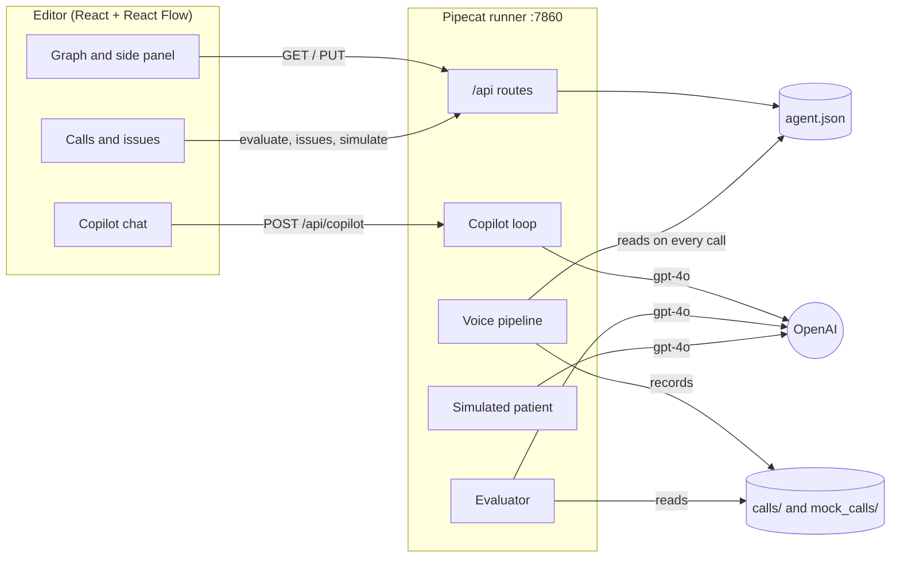

# Agent Studio: a voice-agent editor with an AI Copilot

A take-home for Prosper's Product Engineer role. You can build a healthcare scheduling voice agent as a graph, call it from the browser, and let a Copilot create and improve it. Every change shows on the graph for review before it is saved.

The Copilot closes the loop the challenge describes:

1. **Build.** Paste a client's guidelines. The Copilot asks what blocks the build, then proposes the whole agent.
2. **Detect.** An evaluator reviews calls and points each issue at the node that caused it, with a quote from the call.
3. **Fix.** "Fix with Copilot" proposes the smallest change, drawn on the graph.
4. **Check.** A simulated patient replays the original call against the fix before you accept it.

## Quickstart

You need Python 3.11+ with [uv](https://docs.astral.sh/uv/getting-started/installation/) and Node 20. There is a `frontend/.nvmrc`, so `nvm use` inside `frontend/` picks the right version.

```bash
cp backend/.env.example backend/.env   # then add OPENAI_API_KEY and ELEVENLABS_API_KEY
make install                           # backend (uv.lock) and frontend (package-lock.json)
make run                               # terminal 1: voice agent and API on :7860
make editor                            # terminal 2: open http://localhost:5173
make test                              # every test, 100% coverage required
```

**A demo in five minutes:**

1. Open **Calls & issues** and press **Analyze calls**. Five made-up calls are included; four have real flaws of the example agent.
2. On "Emergency not escalated", press **Fix with Copilot**. The proposal appears on the graph: new parts in blue, edited in amber.
3. Press **Test with simulated patient**. The original caller is replayed against the fix.
4. Press **Accept and save**. The issue is marked resolved.
5. Press **Call** to try the saved agent with your voice. The call is recorded and can be analyzed too.

To build an agent from scratch, use **Use sample client guidelines** in the Copilot panel.

## Architecture



- **The agent is data.** One JSON file, validated by `AgentBuilder`, compiled to Pipecat Flows on every call. Saving it changes the next call without a restart.
- **One server.** The API is mounted on Pipecat's runner app, so the editor, the API and the test call share port 7860. Vite proxies `/api` in development.
- **One way to change the agent.** Manual edits, Copilot proposals and accepted fixes all go through `PUT /api/agent` and the same validation.

## Design decisions

| Decision | Why | Alternative left out |
|---|---|---|
| The Copilot edits through small tools (`add_node`, `edit_edge`…) | Each change is small, validated and listed, and it cannot silently touch what it was not asked to | Asking the LLM for the whole JSON: slow, hard to review |
| One `build_agent` call to build from guidelines | Built piece by piece, `gpt-4o` often left nodes unconnected (2 of 4 valid). One structured call: 5 of 6 valid | Only small tools |
| The model sees the agent's validation errors after every step | Like a linter: it fixes problems as it goes, not only at the end | Validating only the final proposal |
| A visual diff with accept or reject | A clinic's agent should not change unreviewed, and two JSON files are not reviewable | Applying changes directly |
| A fixed list of details that make the Copilot ask (where to transfer, which times to offer) | Left to the model, it asked at random: 1 of 2 runs. With the list: 4 of 4 | Letting the model decide |
| The evaluator drops issues whose quote is not in the transcript or whose node does not exist | A cheap guard against made-up issues | Trusting the model |
| The simulated patient repeats the real caller's lines | Told only the problem, it described symptoms at the greeting and never reached the fixed step | A free-form patient |
| `gpt-4o` for the Copilot, the evaluator and the simulator | Measured: `gpt-4.1` never asked for missing details and ran out of steps building one call per step | `gpt-4.1`, `gpt-4o-mini` |
| Temperature 0.2 for the Copilot and 0 for the evaluator | The same request gives a similar answer; at 1 the Copilot varied a lot | Default temperature |
| JSON files instead of a database | Enough for a single-user prototype, and the runtime already reads JSON | SQLite or Postgres |
| Validation only on the server | One set of rules (`AgentBuilder`); the editor shows what it returns | Duplicating the rules in the frontend |

## Measured with the real models

| What | Result |
|---|---|
| Evaluator on the 5 made-up calls | 4 of 4 issues found, with the expected node; none in the good call; identical across runs; about 2 s in parallel |
| Copilot building from the sample guidelines | Asks the 2 blocking questions 4 of 4 times; valid agent 5 of 6 times |
| "Fix with Copilot" on the 4 issues | Valid fix on the first try for each one |
| Simulated replay of the chest-pain call | Example agent fails; agent fixed by the Copilot passes, twice |

## What it does not do yet

- **About 1 in 6 guideline builds ends with an unreachable node.** The UI blocks accepting it and lists the error; asking the Copilot to fix it resolves it.
- **The simulated patient is text only.** It follows the runtime's rules but not its audio, timing or interruptions; a real call is still needed.
- **Calls are evaluated against the saved agent.** If node names change, older calls lose their links.
- **Single user, no history.** The last save wins, and there are no agent versions; git is the history.
- **Personal data.** Recorded calls stay in `backend/calls/` (git-ignored). Production would need encryption, retention limits and access control.
- **Dev-tool advisories.** The frontend bundle has no known vulnerabilities (`npm audit --omit=dev`). Some test and lint tools (`vitest`, `typescript-eslint`) still have advisories that need major upgrades.

## Repository layout

| Path | What it holds |
|---|---|
| `backend/bot.py` | The voice pipeline. It loads the agent on every call, records the call and mounts the API |
| `backend/agent_builder/` | The agent schema and `AgentBuilder`, which validates the graph and compiles it to Pipecat Flows |
| `backend/api.py` | HTTP routes: agent, Copilot, calls, evaluation, issues, simulation |
| `backend/copilot/` | The Copilot: operations, tool definitions, prompt and loop |
| `backend/evaluator.py`, `simulator.py` | Issue detection and the simulated patient |
| `backend/agent_store.py`, `call_recorder.py`, `issues_store.py` | JSON storage for the agent, calls and issues |
| `backend/mock_calls/` | Five made-up calls for the demo |
| `frontend/src/editor/` | The editor: toolbar, side panels, saving |
| `frontend/src/graph/` | The React Flow canvas, derived from the agent JSON |
| `frontend/src/copilot/`, `diff/`, `review/` | Copilot chat, proposal diff and simulation, calls and issues |

## Tests

`make test` runs both suites, and each fails under 100% coverage. The backend uses pytest, the frontend Vitest and Testing Library, and ESLint bans ternaries.

LLM calls are replaced with scripted fakes in tests, so the suites check behaviour, not model quality; the results above come from running the real models. React Flow cannot measure nodes in jsdom, so canvas callbacks are tested with a stand-in.

## How this was built

It was built with Claude Code as a pair programmer, in 15 pull requests, each reviewed and merged into this fork's `main`. Model choices and prompt changes were decided by running the real models repeatedly and measuring the results above.
