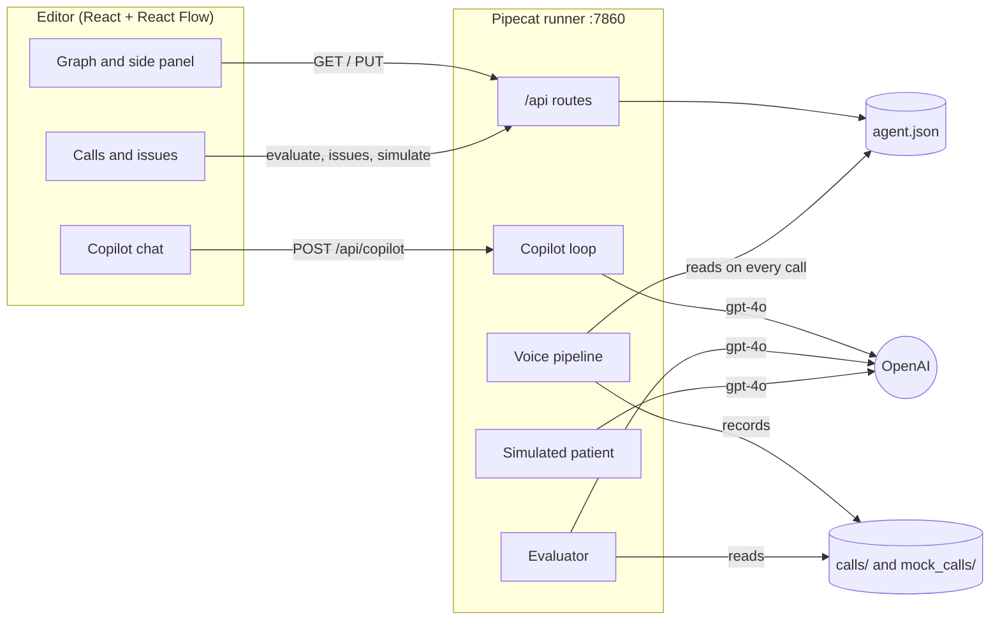

# Solution

Setup and a five-minute demo are in the [README](README.md).

## Overview

The deployment team spends its time on two things: turning a client's guidelines into an agent, and fixing agents when calls go wrong, which first means finding what went wrong. The hard part is not typing the change. It is knowing what to change, where, and being sure the change works.

So the Copilot works like an AI coding tool, as the brief suggests: it makes small, validated edits, shows them as a diff on the graph, and tests them before anything is saved. It covers one loop:

1. **Build.** Paste a client's guidelines. The Copilot asks only for what blocks the build (where to transfer, which times to offer), then proposes the whole agent.
2. **Detect.** An evaluator reads the calls and reports each issue with the node at fault and a quote from the call. Issues reported by a client can be added by hand.
3. **Fix.** "Fix with Copilot" proposes the smallest change, drawn on the graph: new parts in blue, edited in amber, removed crossed out.
4. **Check.** A simulated patient replays the real caller's lines against the proposal. Accepting saves the agent, marks the issue resolved, and the next call uses it.

## Scope

| | What | Why |
|---|---|---|
| **Built** | Graph editor with save and a test call | Phase 1, and a place to show the Copilot's changes |
| **Built** | Copilot, evaluator and simulated patient | The two manual workflows, plus detecting the issues |
| **Mocked** | Five calls, four with real flaws of the example agent; client issues entered in a form | No real call data was provided |
| **Left out** | Users, versions, a database | A single-user prototype; git is the history |
| **Left out** | Applying fixes without review | A clinic's agent should not change unreviewed |
| **Left out** | Voice-level simulation | Text replay catches logic errors cheaply; a real call is still the final check |

## Architecture

- **The agent is data.** I kept the starter's JSON format and `AgentBuilder`, and made validation return every error at once so the Copilot can fix them all.
- **One way to change the agent.** Manual edits, Copilot proposals and accepted fixes all go through `PUT /api/agent` and the same validation. The voice pipeline reads the agent on every call, so no restart is needed.
- **Calls are recorded with the node of each turn.** That is what lets the evaluator point at a node.

## Key decisions

The numbers below come from small runs with the real models (2 to 6 tries each). They were enough to choose between options that differed a lot, but they are not a benchmark: a proper evaluation set with dozens of cases would be the next step.

| Decision | Why |
|---|---|
| The Copilot edits through small tools (`add_node`, `edit_edge`…) and sees the validation errors after every step | Each change is small, listed and checked as it goes, like a linter |
| One `build_agent` call to build from guidelines | Built piece by piece, `gpt-4o` often left nodes unconnected: 2 of 4 valid. In one call: 5 of 6 |
| A fixed checklist of details that make the Copilot ask | Left to the model, it asked 1 time in 2. With the checklist, 4 of 4 |
| The evaluator drops issues whose quote is not in the call or whose node does not exist | A cheap guard against made-up issues. It found 4 of 4 flaws in the mock calls and none in the good one |
| The simulated patient repeats the real caller's lines | Left free, it described symptoms at the greeting and never reached the fixed step |
| `gpt-4o` at low temperature | `gpt-4.1` never asked for missing details. At the default temperature, answers varied a lot |

## Limitations

- About 1 in 6 builds from guidelines has an unreachable node. The UI blocks accepting it and shows the error; asking the Copilot again fixes it.
- The simulated patient is text only, so audio, timing and interruptions still need a real call.
- Calls are checked against the saved agent, so renaming nodes breaks links in older calls, and re-analyzing can reopen a resolved issue.
